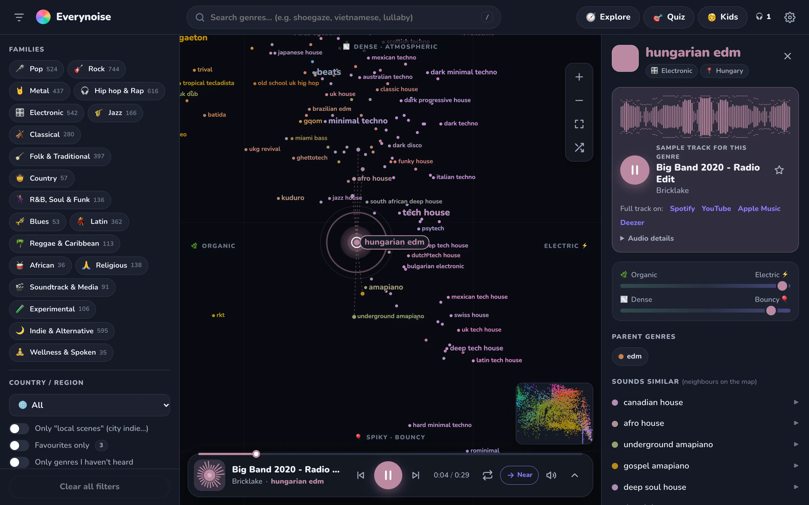
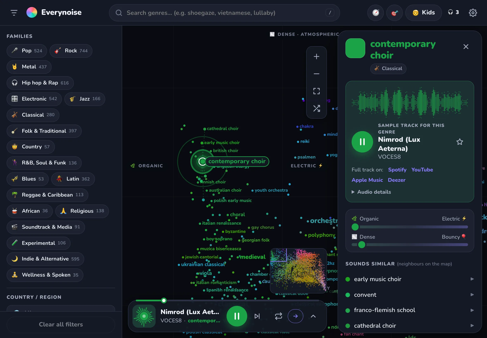
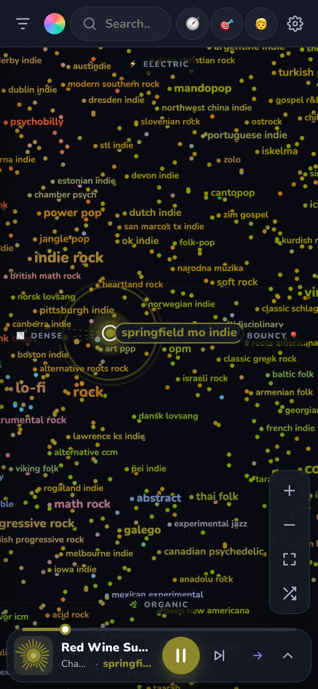
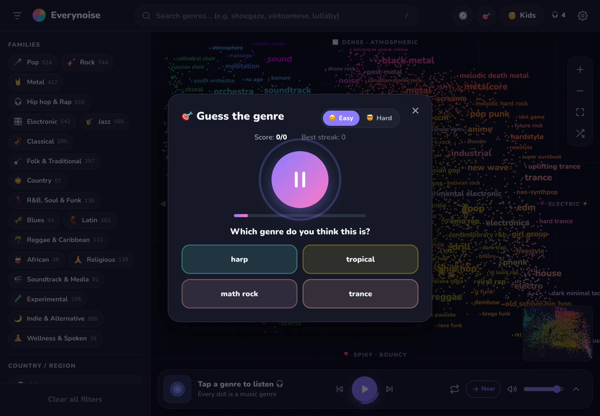
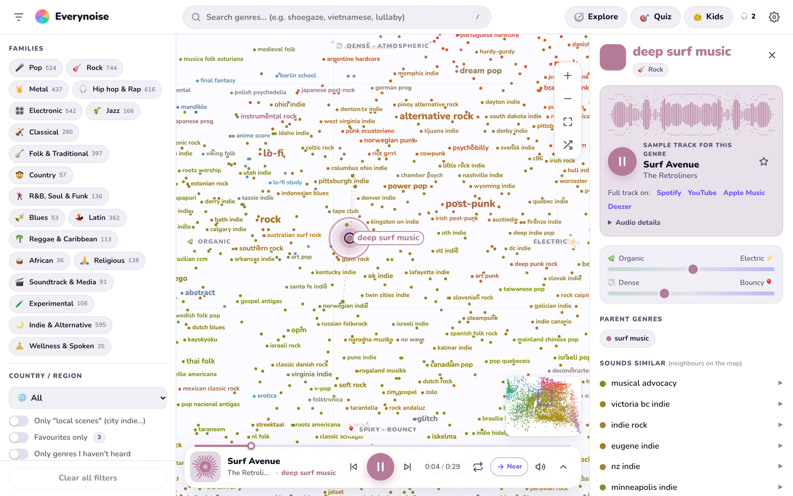

<div align="center">

<a href="https://everynoise.pages.dev"></a>

# Everynoise

**Tap any of 5,986 music genres and hear it in one second.**<br>
A playable map of every genre on Earth, from shoegaze to Vietnamese bolero. Free, no account, works on phone, iPad and desktop.

[**Open the map →**](https://everynoise.pages.dev) · [Features](#features) · [Install as an app](#install-on-ipad--phone-pwa) · [How the map works](#how-every-noise-at-once-works) · [Run locally](#run-locally)

[](https://everynoise.pages.dev)


<a href="https://everynoise.pages.dev"></a>

</div>

## Screenshots

| iPad | Phone | Guess the genre |
|:---:|:---:|:---:|
|  |  |  |

<details>
<summary>Light theme</summary>


</details>

## How Every Noise at Once works

- It is a project by **Glenn McDonald**, made while he was the "data alchemist" at Spotify. Every word on the map is a *micro-genre* that Spotify derived from which artists are listened to together and from audio analysis.
- **Position** comes from the average audio features of the tracks in the genre:
  - vertical axis: organic at the bottom, mechanical and electric at the top
  - horizontal axis: dense and atmospheric on the left, spiky and bouncy on the right
  - genres close to each other usually sound alike.
- **Colour** is also mixed from audio features. **Label size** shows popularity.
- Every genre has a **sample track** (a 30-second Spotify preview) plus up to 5 more by other artists Every Noise lists for that genre (3 for kid-flagged genres). Tap a genre to hear the first; "🎲 Another song" and the track list in the genre panel play the rest (`data/more/`, loaded lazily).
- The original site is one very long static HTML page (each genre is an absolutely positioned `<div>`) and stopped updating at the end of 2023.

## Features

**Map**
- Opens on the whole map. Zoom with the mouse wheel, trackpad, pinch or double-click. Dragging has inertia; there is a minimap.
- Labels fade in by zoom level like a maps app and never overlap.
- The map rotates with the screen: in landscape the organic → electric axis is horizontal, in portrait it keeps the original orientation.

**Floating player**
- Play, pause, previous/next, seek, repeat one, volume and speed (0.75×–1.5×).
- **Auto-advance** after each track: *Near* drifts to a similar genre you haven't heard yet, like a radio wandering across the map. *Random* jumps anywhere. Or off.
- **Music passport** (Explore → Games, or Settings): a shareable 1080×1350 card with a scatter of the genres you heard, countries, top families, rarest genre and a level title. Share (files) on iPad/phone, otherwise download the PNG.
- **Credits** for the playing track: song, artist, full-track links on Spotify, YouTube, Apple Music and Deezer.
- **Audio details**: source, length, Spotify track ID, real frequency spectrum (Web Audio).
- **Beat-reactive visualizer** in the style of NCS videos: mirrored bars (bass in the middle) that jump instantly and fall slowly, with peak caps. Every frequency band has its own auto gain, so dense, loudly mastered tracks still bounce. Kicks are detected in 40–140 Hz; each kick flashes and sends a ring across the map.
- Lock-screen and headphone controls (Media Session). Shortcuts: `Space` play/pause, `N` next, `L` repeat, `←`/`→` seek 5 s.

**Exploring**
- Search with suggestions that tolerate typos ("shogaze" → shoegaze).
- Filter by 19 families, country, local scenes, favourites, "not heard yet", and two sliders on the audio axes.
- Genre detail page: parent genres, subgenres, similar-sounding neighbours.
- 🧭 **Journeys**: Around the world, Music for little ones, Guess the instrument, Time machine, From organic to electric, Random drift. The map flies along with each track.
- 🧭 **Genre path**: pick two genres (or 🎲) and see the shortest chain of genres between them (`p` links + map neighbours), play it as a journey with the route drawn on the map, share it as `#path=a~b`.
- 🎯 **Guess the genre**: listen for 30 seconds and pick 1 of 4 answers. Easy and Hard levels, score and streak.
- 🗺️ **Guess the country**: hear a 30 s preview and tap its country on the world map (10 rounds; exact = 3 pts, neighbour = 1; Easy mode adds 4 country buttons, on by default in kids mode); reveal shows genre and song, then stars.
- 🌍 **Music around the world**: a world map (Explore dialog) coloured by genres per country; tap a country to list and play its genres, or play them all. Pinch/drag to zoom, country search, small places and regions as chips. Country names follow the UI language (`Intl.DisplayNames`).
- 🎧 Counts the genres you have heard. Favourites. Shareable links (`#g=shoegaze`).

**⚙️ Settings** (gear in the top bar)
- Language: Vietnamese / English. Picked from the device on first launch (`vi*` → Vietnamese, anything else → English). Switching is instant and the music keeps playing.
- Theme: auto / light / dark.
- Kids mode.
- Favourites list (tap to play, ✕ to remove).
- Listening history: every genre you heard, newest first, with song and artist; tap to play again (also opens from the 🎧 counter). Can be cleared.
- The running version and **Check for updates**.

**🧒 Kids mode**
- Bigger text and buttons, advanced filters hidden.
- Hides metal, hip hop/rap and genres whose names hint at adult themes.
- Skips Deezer tracks flagged explicit.
- Note: the data has no per-track "explicit" flag for Spotify previews, so this is only a rough filter.

**Devices**: phones (details open as a bottom sheet), iPad (floating panel over the map), desktop (3 columns), light and dark themes.

## Audio

- The sample is the 30-second Spotify preview that Every Noise picked for each genre (`https://p.scdn.co/mp3-preview/<id>`).
- If it fails to load, the player looks up **the same song (same artist, same title)** on Deezer via JSONP (no API key needed) and plays the 30-second preview there. Credits stay the same.
- If both fail, the player shows an error with a Spotify link and, with auto-advance on, moves to the next track.

## Run locally

No build step, no dependencies:

```bash
python3 -m http.server 8000
# open http://localhost:8000
```

## Deploy

The site runs on Cloudflare Pages, project `everynoise` → https://everynoise.pages.dev. Deploys are manual; the project is not connected to GitHub, so pushing does not deploy.

Only the files the page actually loads are uploaded (`scripts/` and `data/raw/` are only for building the data). The script also stamps a new service-worker version:

```bash
./scripts/deploy.sh
```

## Install on iPad / phone (PWA)

1. Open https://everynoise.pages.dev in **Safari**.
2. Tap Share, then **Add to Home Screen**.
3. **Everynoise** appears on the home screen and opens full screen, without the address bar.

- The installed app has its own storage, separate from Safari. Turn on 🧒 Kids mode **once inside the app** and it is remembered.
- The service worker (`sw.js`) caches the UI and the genre data, so the app opens almost instantly and the map works offline.
- **Music is never cached.** Each track streams when you tap it, so listening needs a connection.
- After a deploy, the app runs the old version on the first launch and the new one on the next. To update right away, open ⚙️ Settings, tap **Check for updates**, then **Reload**. All files switch at once, never a mix of old and new.
- On `localhost` the service worker is not registered, so code changes show up immediately.

## Data

| File | Contents | Source |
|---|---|---|
| `data/raw/genre_attrs.csv` | genre name, x/y coordinates, colour | scraped from everynoise.com by [AyrtonB/EveryNoise-Watch](https://github.com/AyrtonB/EveryNoise-Watch) (CC-BY-SA 4.0) |
| `data/raw/previews.json` | genre → preview, Spotify track ID, artist, song | extracted from [jtbartee/everynoise-jukebox](https://github.com/jtbartee/everynoise-jukebox) (original everynoise.com data) |

`python3 scripts/build_data.py` produces:

- `data/genres.json`: positions, colours and derived fields.
  - `f`: families
  - `co`: country
  - `s`: local scene
  - `p` / `k`: parent genres and number of subgenres
  - `kid`: passes the kids filter
  - `ap`: estimated position

  533 genres appear only in the preview list and have no coordinates. The script places them next to their parent genre and marks them as "estimated position".
- `data/tracks.json`: sample tracks, in the same order as `genres.json`. The page loads it after the map is shown.

Families, countries and the kids flag are guessed from genre names, so some are wrong. Fix the dictionaries in the script and run it again.

## Structure

```
index.html
manifest.webmanifest  PWA: name, icons, full-screen mode
sw.js                 caches the UI + data (never audio)
icons/                app icons (icon.svg is the source)
css/style.css         UI, light/dark themes, responsive layout, kids mode
js/main.js            wires everything: search, filters, detail panel, settings, shortcuts, URL
js/map.js             two-layer canvas renderer, zoom-based labels, sprite cache, gestures
js/player.js          player: Spotify preview → Deezer fallback, visualizer, Media Session
js/beat.js            audio analysis: bouncing bars (per-band auto gain) + kick detection
js/i18n.js            Vietnamese / English: Vietnamese strings are the keys, EN table translates
js/tours.js           journeys
js/quiz.js            genre quiz
js/passport.js        music passport: 1080×1350 share card (canvas) from the genres heard
js/path.js            genre path (Dijkstra over parent links + map neighbours)
js/world.js           world music map (lazy-loads data/world.json)
js/geoguess.js        "guess the country" game (own SVG from data/world.json)
js/data.js            data loading, nearest neighbours
scripts/build_data.py
scripts/deploy.sh     builds dist/ and deploys to Cloudflare Pages (BRANCH=x for a preview URL)
fonts/                Nunito, self-hosted (latin, latin-ext, vietnamese)
robots.txt sitemap.xml _headers   SEO + cache headers for Cloudflare Pages
AGENTS.md             notes for coding agents
docs/                 README screenshots
```

Load and playback performance:
- `index.html` preloads the genre data, the font and every JS module, so nothing waits for the previous file to be parsed (genre data now starts at ~0.25 s instead of ~4 s on a throttled Lighthouse run).
- No third-party requests at startup (fonts are self-hosted).
- With auto-advance on, the next track is chosen 8 s early and its preview is fetched into the browser cache: the silence between tracks dropped from ~380 ms to ~10 ms.

Map performance:
- The base layer (dots + labels) only redraws when the map moves.
- The "now playing" pulse and selection ring live on a separate layer.
- The label set for each zoom level is precomputed while the browser is idle.
- Each label is cached as a small bitmap, so dragging the map costs about 1 ms per frame.

Genre data © Glenn McDonald / everynoise.com. Audio belongs to the artists and the platforms that publish it. Everynoise only plays public previews and always credits them.
